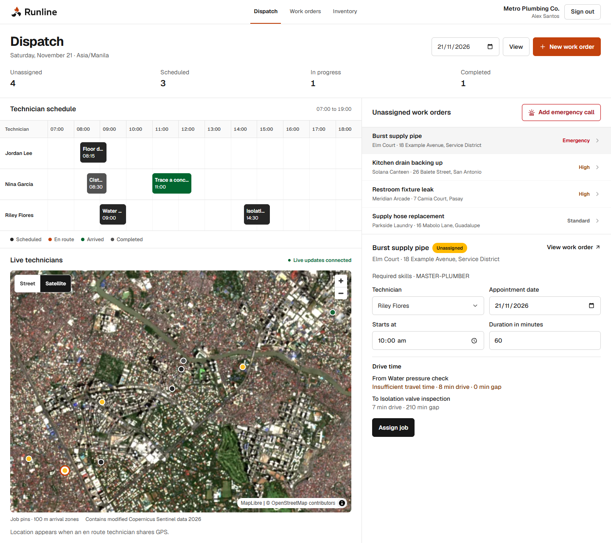
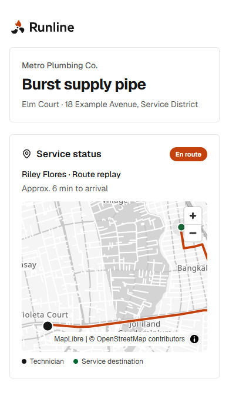
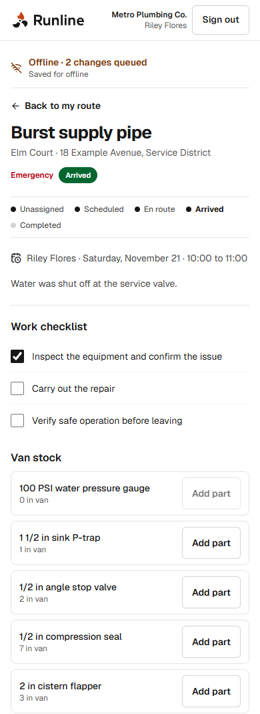
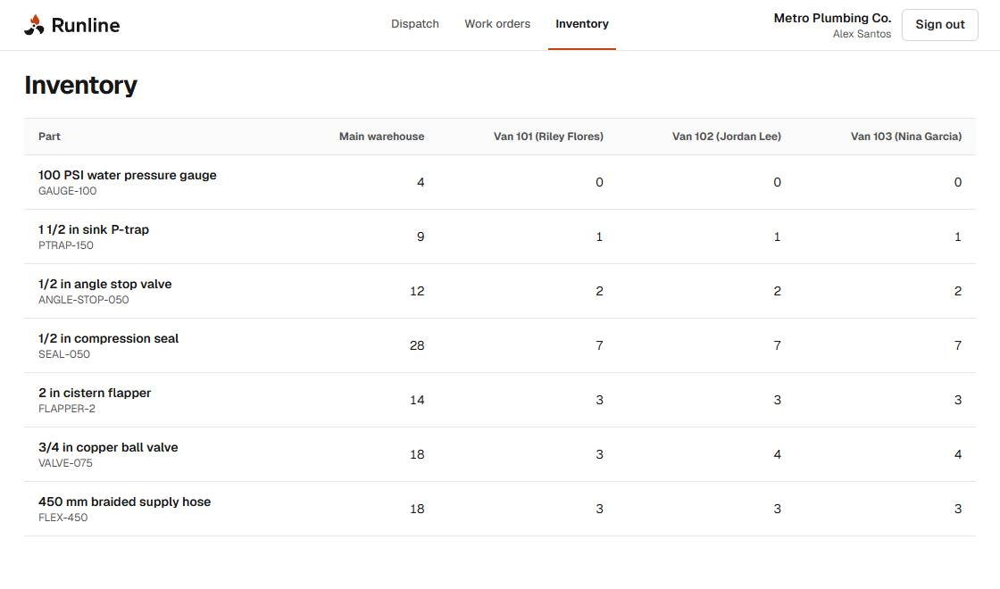
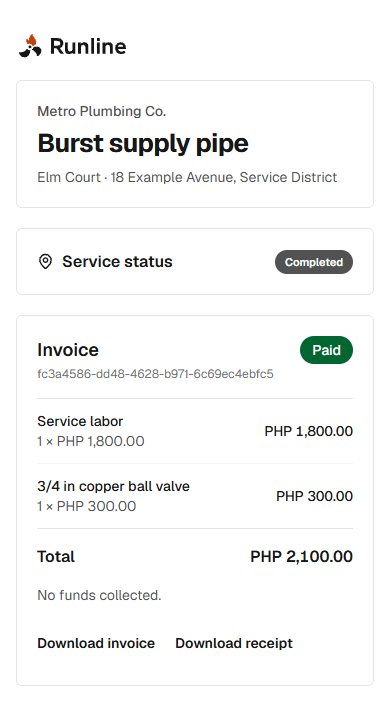
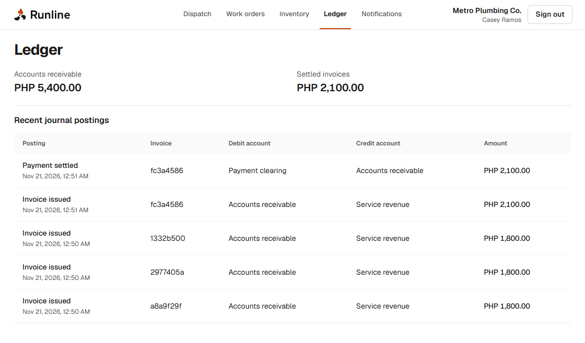

# Runline

Runline is a self-hosted field service app for HVAC contractors. Dispatchers schedule jobs and track technicians, technicians record work offline, and customers follow their visit through to an itemized receipt.

[Run locally](#run-locally) · [Walkthrough](#walk-through-a-service-call) · [How it works](#how-it-works) · [Host on a VPS](#host-on-a-vps) · [CI](https://github.com/domnatz/runline/actions/workflows/ci.yml)

## Run locally

Start the Docker Compose stack using the [local setup guide](deploy/operations.md#run-locally). The first start applies the database migrations and loads two sample organizations. Open [Runline](http://localhost:3000/login) and choose a role, or choose **Open customer tracking** to see a completed visit. Checkout collects zero funds.

## Walk through a service call

These screenshots follow **Burst supply pipe**, a sample call for Metro Plumbing Co. Use separate browser profiles for Dispatcher, Admin, Technician, and the customer link so each view keeps its own session.

### 1. Assign a technician

As **Dispatcher**, select the job from the queue or map and choose the recommended technician, Riley Flores. Set the start to **10:00**. The previous visit ends at 10:00, and OSRM estimates eight minutes of driving, so the board flags the zero-minute gap. Assign the job to continue the walkthrough.

### 2. Follow the route to arrival

As **Admin**, open **Notifications** and copy the tracking link from the appointment event. Open it in the customer profile. As **Technician**, mark the job en route and choose **Replay route**. The customer sees Riley’s position and ETA. Entering the arrival zone moves the job to **Arrived** and records the transition in the [work-order audit history](assets/screenshots/work-order-audit.webp).

### 3. Record the work offline

Leave **Inventory** open in the dispatcher profile. Set the technician tab’s network to **Offline** in browser DevTools. Check the inspection task and choose **Add part** on the **3/4 in copper ball valve**. The technician screen shows two queued changes. Choose **Complete job** and confirm, then reload while offline to see the saved work and pending completion.

| Customer tracking | Technician offline |
| --- | --- |
|  |  |

### 4. Reconnect and check inventory

Turn the technician tab’s network back on. Runline syncs the queued changes and finishes the job. Riley’s van drops from **four copper ball valves to three** in the inventory tab that was already open.

### 5. Settle the invoice and download the receipt

The customer portal shows the labor and part on a **PHP 2,100** invoice. Choose **Record payment** and download the PDF receipt. To exercise a retry, use **Delay confirmation** and then **Retry same payment**. The admin ledger shows one invoice issuance and one settlement for that invoice.

| Customer receipt | Admin ledger |
| --- | --- |
|  |  |

## How it works

Next.js and React serve the staff workspace, technician PWA, and customer portal. Express runs the API. PostgreSQL and PostGIS store work orders, stock, and location data. The route engine uses OSRM for drive times. A PDF worker uses BullMQ and Redis and stores finished documents privately in SeaweedFS.

| What to look at | How it works |
| --- | --- |
| Scheduling and arrival | PostgreSQL blocks overlapping appointments for a technician. OSRM adds travel-time warnings, and PostGIS checks the 100-metre arrival zone using GPS accuracy. [Scheduling constraints](apps/api/db/migrations/003_work_orders.sql) · [Route planning](apps/api/src/features/dispatch/planning.ts) · [Location updates](apps/api/src/features/tracking/location.ts) |
| Offline edits and stock | Dexie keeps the route and queued writes on the device. Each retry reuses the original mutation ID. PostgreSQL records the result and any stock deduction in one transaction. [Offline storage](apps/web/src/features/field/storage.ts) · [Sync transaction](apps/api/src/features/field/sync.ts) |
| Live updates | Database notifications wake server-sent event streams after a commit. Dispatch, customer tracking, and inventory receive fresh snapshots, including after a reconnect. [Event listener](apps/api/src/realtime/events.ts) · [Snapshot stream](apps/api/src/realtime/stream.ts) |
| Tenant and customer access | The API derives tenant and role from the session. PostgreSQL row-level security scopes records to that tenant. A customer’s signed link grants access to one work order. [Tenant transaction](apps/api/src/db/tenant-transaction.ts) · [Work-order policies](apps/api/db/migrations/003_work_orders.sql) · [Customer link](apps/api/src/features/billing/customer-link.ts) |
| Billing and documents | Payment retries return a saved result. Invoice issuance and settlement post balanced journal entries. The separate worker prepares downloadable PDFs. [Payment handling](apps/api/src/features/billing/checkout.ts) · [Billing schema](apps/api/db/migrations/005_billing.sql) · [PDF worker](apps/api/src/document-worker.ts) |

GitHub Actions checks lint, types, production builds, and a Compose startup against PostgreSQL and PostGIS. It also reruns migrations and seeds. [CI workflow](https://github.com/domnatz/runline/actions/workflows/ci.yml) · [Local OpenAPI schema](http://localhost:3000/api/openapi.json)

## Host on a VPS

The reviewer stack serves the sample workspace over HTTPS with Caddy. The operations guide covers host setup, private credentials, data reset, backups, and restore. [VPS setup and recovery](deploy/operations.md#host-a-reviewer-instance)

## Map data

The Metro Manila basemap and routing graph run locally. The map uses Protomaps data from 2026-11-18, and the road graph uses a SliceOSM extract from 2026-11-19. Map data is copyright OpenStreetMap contributors and available under the ODbL. [Protomaps downloads](https://docs.protomaps.com/basemaps/downloads) · [SliceOSM](https://slice.openstreetmap.us/) · [OpenStreetMap copyright](https://www.openstreetmap.org/copyright)

The Metro Manila satellite view contains modified Copernicus Sentinel data 2026. It uses a cropped and reprojected Sentinel-2 scene captured on March 19, 2026, in Earth Search. [Source scene](https://earth-search.aws.element84.com/v1/collections/sentinel-2-l2a/items/S2A_51PTS_20260319_0_L2A) · [Sentinel data licence](https://ewds.climate.copernicus.eu/licences/ec-sentinel)
